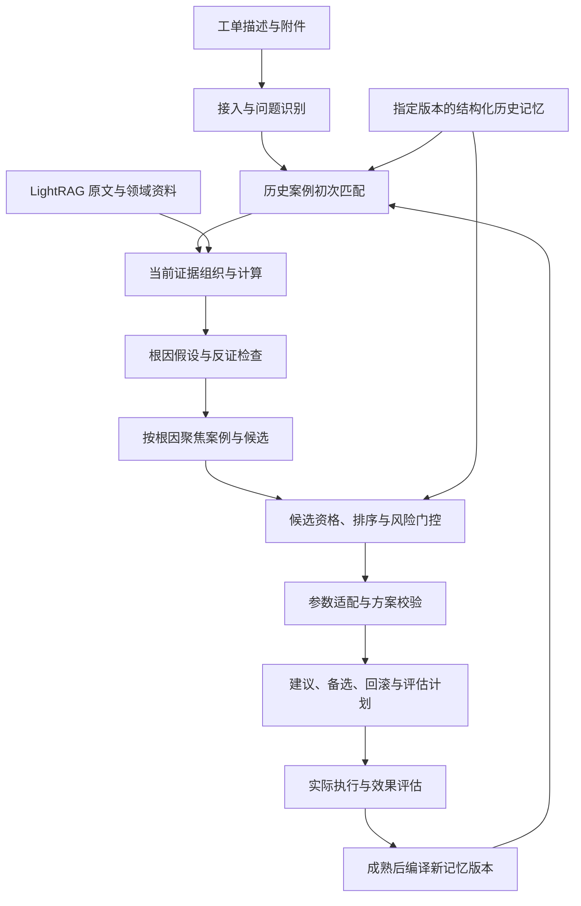

# 无线工单分析与优化方案：ECHO-Mem 迁移分析

分析日期：2026-10-08。工作分支：`wireless-network-optimization`。

同日补充：仓库根目录另有 1 条结构化脱敏演示工单、279 条动作语义映射、归并审核规则及叙述案例，见[可用语料清单](available-corpus.md)。这些材料与复现子目录缺失的 4 条合成输入分别记录。

2026-10-10 职责调整：当前 13 个网优 Skill、9 个领域工具，分为历史驱动分析与工单记忆工程。根因、数据、参数应用与方案分析必须执行 `wireless_history_search` 或复用同条件检索结果，自动查询固定经验与本地六类记忆包。未命中、未接入生产库、读取失败分别报告；已有经验全部保留。工程入口复用分析能力，负责记录、评价与编译，普通问答无需先创建工单。

呈现围绕历史对照与当前判断：解释工单现象、历史动作/结果、当前适用差异与反证，保留简短案例标识和记忆版本；链接按需提供。页面展示实际历史检索范围与命中状态。Qwen 文本请求关闭推理模式，实时流与历史展示不包含原始推理。工具成功、信息待补、方案保存与效果达标分别判断，整单评价不归给单独参数。

初始 10 个网优阶段 Skill 与 `wireless-echo-mem` 保留，新增 `wireless-data-analysis`、`wireless-memory-engineering`。源实验步骤到当前入口的映射见 [ECHO-Mem 分析契约](../../skills/wireless-workorder-orchestrator/references/echo-analysis-method.md) 和 [工程步骤](../../skills/wireless-memory-engineering/references/engineering-steps.md)。已接入可解释历史检索、源状态分池、当前证据核对与参数约束；源 ranker/值选择消费者已可按需运行，完整结构导航和校准 gate 仍待接入，下文的完整设计不能当作运行证明。

这次迁移的核心是把 ECHO-Mem 的结构化运维记忆接到 Harness：新工单进入后，能够追溯历史案例，区分支持与反证，组织当前证据，解释候选根因，输出具有适用条件、参数依据和回滚条件的优化方案。

## 1. 来源快照与核查范围

源仓库：`Jinbo666/wireless_knowledge_compilation`。

- 固定提交：[`e734ac032a7dc671878d05cd40d2b31b68d156fc`](https://github.com/Jinbo666/wireless_knowledge_compilation/commit/e734ac032a7dc671878d05cd40d2b31b68d156fc)，2026-09-29 17:05:20 +0800。
- 用户指定目录：`echo-mem-reproducibility/`，Git 树包含 162 个文件，其中 97 个 Python 文件、18 个 Schema、29 个实验脚本、7 份协议。
- 精读范围：公开运行入口、数据与复现边界、7 份协议、核心输入/记忆 Schema、准入与归因、编译关键分支、生命周期、评分、证据画像、案例召回、候选排序、参数值选择、反证门控、版本读取及相关实验配置。
- 补充核查仓库根目录的 8 个无线 Skill、中文/英文历史数据适配器、产品 API、分层记忆读取与 Agent 工具。这些补充实现与复现子目录分别记录，避免混用版本边界。
- 执行公开 `run.py verify`，另以人工构造输入验证 8 项关键机制。全量私有数据实验没有在本机重跑。

复现子目录对应 2026-09-09 锁定的 ECHO-Mem JSAC 稿，9 月 29 日更新交接与运行检查；之后独立开展的 Shadow Replay 研究不在该目录的声明范围。论文冻结结果与本机运行结果应分别保存。[S1]、[S2]

## 2. 源项目已有能力及其产品价值

| 能力 | 已有实现 | 对新工单分析的作用 | 迁移边界 |
| --- | --- | --- | --- |
| 历史工单标准化 | 根目录 `pipeline/ingest/` 的中文、ICOS 英文适配器；TraceRecord Schema | 把多行参数执行记录聚合成一个工单，保留动作和来源 | 这是历史执行记录入口；新工单需要独立输入契约。复现子目录没有这两个具体适配器 |
| 效果学习准入 | `compile_eligibility.py` | 区分可学习效果的工单、未知效果和执行风险 | `mixed` 可进入学习池，但不能因此计成二元成功或失败证据 |
| 证据归因 | `outcome_compilation.py` | 区分单动作直接证据、组合方案证据、组件关联和未决证据 | 一套组合方案有效，不能给每个组件分别记一次成功 |
| 六类运维记忆 | `compile_rules.py`、MemoryObject Schema | 保存案例、根因标签、参数策略、组合方案、落地风险、效果反证 | 成功案例与失败案例必须共同保留 |
| 可信度与状态 | Bayesian LCB、`transition/state.py`、`scoring/score.py` | 压低小样本偶然成功，控制可推荐候选池 | 状态与分数有版本；分数不代表新工单一定改善 |
| 证据画像 | `memory_evidence_profiles.py` | 支持、反证、冲突、稀疏分别呈现 | 画像、生命周期、使用资格需要分开保存 |
| 结构召回与排序 | `shadow/retrieve.py`、`navigation.py`、`plan_ranker.py` | 从问题类型进入方案族，比较适用环境、可信度和边界 | 部分匹配为软信号，产品需要明确厂家/制式不兼容时的资格约束 |
| 参数值选择 | `action_value_selector.py` | 用历史值形态、方向、范围和当前快照生成候选值 | 缺失快照时存在推定值回退，产品不能把推定值呈现为当前值 |
| 反证门控 | `failcohort_veto_gate.py` | 将风险候选接受、降级、送复核或拒绝 | 校准文件、阈值版本和证据特异性必须可查 |
| 持续记忆与时间约束 | `version_delta.py`、continual replay 协议 | 只学习决策时已经可见、成熟的历史效果 | 实验采用的 7 天延迟是冻结实验口径；生产应使用实际评估成熟时间 |
| Agent 分层读取 | 根目录 `agent_memory_tools.py`、`hierarchical_memory_access.py` | 读取候选的画像、近期变化和来源案例 | 这两项根目录实现不在复现子目录内，适合作为另外固定版本的迁移模块 |

以上实现可以形成一个有证据的案例决策系统。当前源数据没有直接提供完整的新工单 KPI/MR 诊断链，根因记忆以历史 `type1/type2` 标签及方案族信息为主。产品 API 文档也明确把这类根因作为弱提示。[S3]、[S4]、[S5]、[S6]、[S7]、[S8]

### 2.1 六类记忆应怎样使用

| 记忆类型 | 保存什么 | 在新工单中的用途 |
| --- | --- | --- |
| `case_memory` | 一个历史工单的场景、动作、结果、证据来源 | 逐案比较相同点、差异、执行结果与可迁移部分 |
| `rca_memory` | 历史问题与一级/二级根因标签的关系 | 生成根因假设，辅助检索；当前工单需另行验证 |
| `strategy_memory` | 参数语义、调整方向、值模式及历史支持 | 生成单动作候选，保留适用环境和统计分母 |
| `playbook_memory` | 多动作组合、组件关系及组合效果 | 输出完整方案，保留组合归因与执行顺序约束 |
| `risk_memory` | 业务执行约束、下发或审核风险 | 判断能否落地、需要哪些前置检查 |
| `counter_evidence_memory` | 明确失败与对应动作/场景边界 | 排除危险候选，或形成需要复核的反对证据 |

源 `wireless-knowledge-compiler/SKILL.md` 仍写“五类记忆”，实际 Schema 和编译器已经有 `playbook_memory`，迁移时按代码修正文档。[S3]、[S4]、[S9]

### 2.2 三项必须保留的机制

**效果归因的粒度。** 严格单动作方案、确实执行且有成熟二元效果，才可能获得 `action_direct`。多动作只观察到整体结果时，组件保持 `component_associated`；多动作计划只成功执行一个动作，也不能悄悄改成严格单动作实验。`long_eval_mixed` 留作组合/冲突记录，不广播为多个二元效果。[S5]

**小样本与冲突。** 现场独立探针中，1/1 成功的原始通过率为 100%，LCB 为 0.223607；100/120 成功的原始通过率约 83.33%，LCB 为 0.768950。1/1 策略保持 `unverified`。所以模型必须同时展示样本量、效果分母与不确定性，不能只比较通过率。LCB 是历史效果统计的保守量，并非当前根因成立概率。[S6]

**决策时可见的记忆。** 固定 `package_version`、`evidence_cutoff`、来源哈希、规则与门控版本。先冻结本单决策，再揭示本单结果；成熟结果只能影响未来版本。历史标签、修改后参数值、长评估结果不能进入本单决策特征。[S10]、[S11]

## 3. 实验内容如何转成工程规则

| 实验/协议族 | 它验证的问题 | 在 harness-wiki 中沉淀什么 |
| --- | --- | --- |
| Evidence Authority 及传播审计 | 把组合效果广播到单动作是否越权 | 归因 Schema、编译准入、证据到候选的来源链、硬否决资格检查 |
| Construction ablation | 去掉参数规范化、值抽象、支持/冲突机制会改变什么 | 参数本体与规范化规则包、编译配置、回归样例；不按每个消融实验新建 Skill |
| Structural identity granularity | 按方向、值形态、边界聚合会怎样影响召回 | 候选身份规则，粗到细检索，记录跨粒度投影与分组版本 |
| Outcome risk / fixed-budget readout | 在固定复核预算下能抓住多少历史失败 | 门控与排序的离线验收，保留失败计数和分母；避免把生命周期状态直接映射成失败概率 |
| Continual replay / maturity | 新效果在成熟后是否改善后续决策 | 时间准入、版本增量、近期证据、旧成功与新失败冲突的复核机制 |
| Agent-facing readout | 模型读到记忆后如何选择受限候选 | 候选 ID 选择、JSON 输出校验、工具读取审计、确定性动作物化 |
| Statistics gate | 如何避免换口径、预算和舍入改变结论 | 冻结评测集、站点/时间隔离、统计分母、预先固定主指标与比较方法 |

本次采用这些实验提供的机制和验收设计。论文表格的冻结数字需要受控数据、组合/风险 sidecar、初始 bootstrap 或决策分数账本等输入；不用于声明本产品的真实优化效果。Table S6 的抽取驱动仍以冻结分数账本为起点，上游重新生成账本未全部抽取。[S2]、[S12]

## 4. 当前 13 个网优 Skill 与完整能力设计

Skill 数量按独立输入、输出与决策责任划分。LTE/NR、厂家、弱覆盖/干扰/切换等放在适用条件、参考资料和规则包中。确定性门控是共用工具，避免每个 Skill 自行解释一套风险规则。

| Skill | 来源 | 主要输入 → 输出 | 必须有的执行能力 |
| --- | --- | --- | --- |
| `wireless-workorder-orchestrator` | 改造已有 | 当前输入 → 历史对照、数据/根因/方案回答 | 实际历史检索、经验与当前条件比对；普通分析不要求持久化 |
| `wireless-data-analysis` | 职责调整新增 | 当前指标/附件 → 数据发现、历史对照与根因线索 | 历史检索、真实口径与数值计算、可比性与异常判据来源 |
| `wireless-memory-engineering` | 职责调整新增 | 工单处理/记录/沉淀请求 → 工单阶段与记忆版本 | 编排持久化、反馈/评价/编译；分析阶段复用历史驱动入口 |
| `wireless-workorder-intake` | 改造已有 | 描述/附件/结构化工单 → `WorkOrderInput` | 对象与时间标准化、附件溯源、缺失字段标记、稳定工单 ID |
| `wireless-problem-identification` | 改造已有 | 工单及初步指标 → 问题类型、严重度、候选问题 | 问题分类、指标口径；症状与根因分开 |
| **`wireless-case-retrieval`** | **新增** | 问题、场景、对象、截止时间 → 历史案例对比包 | 结构过滤、语义补召回、ID 去重、来源展开、成功/失败/冲突比较、近期证据 |
| `wireless-evidence-builder` | 改造已有 | 当前证据和案例 → `EvidencePackage` | KPI/MR/KQI/告警/邻区/参数对齐，确定性统计，支持/反对/未知证据归类 |
| `wireless-root-cause-analysis` | 改造已有 | 历史根因/案例与当前证据 → 假设对照与区分检查 | 必须查历史再对照当前支持/反对，历史标签只作先验 |
| `wireless-solution-decision` | 改造已有 | 根因、可用记忆与约束 → 候选方案选择及备选 | 资格过滤、排序、反证门控、候选 ID 校验；模型说明选择理由 |
| **`wireless-parameter-adaptation`** | **新增** | 已选候选、当前参数快照与规则 → 可落地方案或条件方案 | 厂家/制式/版本/单位/范围/步长、跨参数约束、动作顺序、回滚值与触发条件校验 |
| `wireless-effect-evaluation` | 改造已有 | 冻结方案、实际执行、前后观测 → 效果/副作用/归因/成熟状态 | 同对象同口径的窗口比较、评估充分性、执行失败和效果失败分开 |
| `wireless-knowledge-compiler` | 改造已有 | 已成熟历史 TraceRecord → 新版本 Memory Package | 准入、去重、归因、六类编译、状态、评分、画像、版本发布与来源索引 |
| `wireless-echo-mem` | 替换通用知识 Skill | ECHO-Mem 原理/字段/实现问题 → 来源解释 | 固定提交的协议、Schema、代码、实验边界与实际集成状态；按来源继续阅读 |

两个新增 Skill 各有明确用途：案例对比需要输出“为何相似、哪里不同、哪些经验可迁移、哪些失败限制该方案”；参数适配需要把历史动作转成当前对象能执行的值与顺序。源工程已经有它们的部分算法，新增的是完整的产品操作契约与工具衔接。

每个 Skill 最终采用 `SKILL.md + references + 受控工具`。厂家参数、问题分类、指标口径、案例格式、反证解释等参考按需读取；共同 Schema 与规则只有一个事实源。8 个现有 Skill 是领域流程说明，复制进目录并不等于其依赖能力可执行。

## 5. 一张工单进来后的流程

1. **固定工单上下文。** 记录小区/网元、厂家、制式、频段、室内外、症状、时间窗和附件。未知信息保持未知。输入包含历史方案或执行结果时，另存评价分区，避免进入决策区。
2. **先做粗匹配。** 按问题和场景找到可解释的历史案例、失败案例和候选方案族。精确不兼容的厂家参数不进入可执行候选；可作为跨厂家概念参考的案例需标明差异。
3. **组织当前证据。** 核对对象、窗口、粒度、计数器含义、单位与数据完整性，计算可支持的指标。只有工单文字时，交付案例支持的假设和补查项；有数据时再展开指标分析。
4. **验证根因并再次匹配。** 每个根因记录支持证据、反对证据、未排除原因和区分检查。用新得到的证据聚焦检索，限制无增益的重复调用。
5. **生成受限候选。** 确定性工具返回候选身份、适用条件、样本量、可信度、组合归因和反证。模型选择已有候选 ID，工具按 ID 物化动作。复杂工单可组合多个已验证候选组件，但要重新检查组合兼容性，不能凭文字发明统计支持。
6. **适配当前参数。** 从决策前可信快照取当前值，检查对象、厂家版本、范围、步长和跨参数依赖。缺少快照时输出调整方向/条件方案和具体补查项；推定值只作为分析假设。
7. **冻结建议与评估计划。** 输出推荐、备选、风险、回滚、观察窗和指标口径。后续执行回执作为独立事件关联。评估成熟后再更新未来记忆包。

案例召回不足、证据冲突和数据缺失都是正式状态，不能通过生成更多文字变成“已诊断”。接受一条建议只表示建议通过当前门控；网络配置下发需要单独的执行接口与业务授权。

## 6. 数据契约：新工单与历史记录分开

以下是完整闭环的目标契约。当前已落地工单输入/版本、证据与假设引用、候选方案/实际反馈版本与事件历史、关联执行的效果比较和源规则记忆包，字段约定见 `skills/wireless-workorder-orchestrator/references/input-contracts.md`；完整结构导航、校准 gate、跨参数规则与生产发布仍需后续实现。

| 对象 | 核心字段 | 边界 |
| --- | --- | --- |
| `WorkOrderInput` | `workorder_id`、来源、对象、症状、厂家/制式/版本、场景、分析时间窗、附件、`decision_at` | 不要求已有动作/结果；原始附件字段按可见时间和角色分类 |
| `EvidencePackage` | 证据 ID、类型、对象、采集窗、粒度、单位、指标口径、计算方法、质量、来源、`available_at` | 所有统计可追溯，分母与缺失标记保留；支持/反证可同时存在 |
| `CaseComparison` | 当前与历史字段对照、匹配理由、关键差异、历史动作/结果、归因范围、可迁移部分、反证 | 语义相似度与适用性分别记录；同一 Trace 不重复增加支持数 |
| `RootCauseAssessment` | 候选根因、支持/反对证据、区分检查、未排除项、证据充分性 | 历史标签、当前确认、模型假设有不同标记；不把 LCB 当根因概率 |
| `OptimizationProposal` | 候选/组件 ID、适用对象、当前值与来源、目标值或方向、约束、顺序、风险、备选、回滚、评估计划 | 数值由工具校验；缺当前快照不能宣称生成了可下发参数方案 |
| `EvaluationRecord` | 执行回执、前后指标、可比性、副作用、通过/失败/未知、归因范围、成熟时间 | 执行成功与效果改善分开；方案组合结果不自动拆成单动作效果 |
| 历史 `TraceRecord` | 已执行动作、执行/评估事件、场景与来源 | 保留源契约，用于历史编译和评价。当前 Schema 要求非空 `actions`，不能直接当新工单入口 |
| `MemoryPackageManifest` | 来源提交/数据哈希、规则与本体版本、画像/状态、截止时间、包版本、增量关系 | 不可变发布，原始数据、画像与来源案例可按版本重建 |

来源链至少覆盖：`workorder → evidence → compared_trace → memory/profile → selected_candidate → proposal → execution → evaluation → future_package`。当前聊天会话 ID 可以关联工单，但工单状态不能依赖模型上下文才能恢复。[S3]、[S10]、[S11]

## 7. 接入 harness-wiki 的技术方案

### 7.1 三层存储与执行

**原文与领域资料层：继续使用 MinerU + LightRAG。** 解析网优手册、案例报告 PDF、参数说明与研究文档，提供原文、关系和解释性资料。关键表格中的数值、单位和对象身份需要转换为有校验的结构记录后才能参加参数计算。

**结构化记忆层：引入 ECHO-Mem worker 与版本库。** Python 3.12 独立运行，沿用准入、归因、编译、评分、画像与读取模块。首版可以用不可变 JSONL 包加本地 SQLite 索引；查询返回精确案例与证据 ID、统计分母、状态和版本。规模扩大时再替换索引后端，保持同一工具契约。

**编排层：Harness 加网优插件和工单账本。** 建议新增 `backend/dsh/dsh-wireless/`，把 worker 能力注册为模型可用工具，并新增无线 profile。项目级 Skill 放 `skills/wireless-*/`。工单账本持久化阶段、输入版本、工具结果摘要、作业状态和产物；服务重启后按工单 ID 继续工作。

源根目录的三个只读入口值得优先复用：

| 源入口 | 返回内容 | Harness 适配要求 |
| --- | --- | --- |
| `GET_MEMORY_PROFILE` | 候选对应记忆与治理画像 | 绑定工单可用候选集合、固定 as-of 版本、保留多记忆匹配 |
| `GET_RECENT_EVIDENCE` | 近期证据及状态/来源变化 | 近期视图只是时间切片，不能伪装为新的正式证据状态 |
| `GET_MEMORY_CASES` | 去重的来源案例，最多 5 条 | 展示案例原始动作、结果和归因，标注返回数量与截断；完整检索入口另行分页 |

这些是 Python 适配类中的方法，仍需注册、Schema 校验、访问控制、超时和服务桥接，才能成为当前 Harness 的工具。[S8]

### 7.2 需要的工具责任

| 工具责任 | 实现来源 | 关键约束 |
| --- | --- | --- |
| 工单接入/状态读取 | 新建 Node 账本与 Schema | 幂等、输入版本、可恢复阶段 |
| 案例搜索/比较 | 源结构召回 + 新对比接口 + LightRAG 补召回 | 稳定 ID、时点约束、去重、显示不匹配与反证 |
| 记忆画像/近期证据/案例展开 | 源三个 Agent 工具 | 固定版本，只读，不借查询改变正式记忆 |
| 当前网络证据读取 | 新文件适配器，后续接现网只读 API | 对象、时间、单位、数据质量、来源身份 |
| 证据计算/诊断检查 | 新确定性指标与规则模块 | 口径和阈值有出处，缺失时降级结论 |
| 候选枚举/排序/门控 | 源 ranker、gate，按产品契约适配 | 资格与风险分开；校准缺失有明确状态，不能宣称已校准 |
| 参数适配/方案校验 | 源值选择器 + 厂家参数规则包 | 保留 observed/imputed/unavailable，约束、顺序、回滚一致 |
| 效果评估 | 新评估模块，对接源归因与编译规则 | 前后可比性、成熟时间、组合归因 |
| 历史编译/版本发布 | 源 compiler、state、score、package | 独立作业目录、显式输入路径、不可变包与发布指针 |

工具名与数量在实际 Schema 设计时确定，不要求与 Skill 一一对应。

### 7.3 当前基础必须调整的地方

- 现有项目 Skill 发现与 `skill` 加载已可复用。当前 persona 定位为“知识库运营助手”，无线工单需要独立 profile 和路由，避免按普通知识问答的短回复目标压缩诊断交付。
- `kb_analyze`、`kb_diagnosis_submit` 等针对知识库质量与反馈治理，不是无线 KPI 根因工具；领域工具使用独立命名与契约。
- 当前 `lightrag_query_data` 只接受 `company` 知识库。若需要独立无线知识空间，应同步适配真实远程实例/数据隔离能力；单改调用参数 `kb=wireless` 会失败。
- 当前后端镜像是 Node 24 + zstd，没有 Python。建议 worker 使用单独镜像与固定依赖，Node 插件通过内网受控接口调用。
- 源 Python 的默认路径和若干可变全局配置来自研究工程。封装时显式传入任务目录、历史边界、风险输入和规则配置；并发作业采用进程隔离，避免跨工单污染。
- 长任务需要实际的取消、超时和恢复；取消一张工单不能关闭共享 Harness。工单恢复以持久化输入和工具产物为依据。
- LightRAG 中的摘要应带 Trace/Memory/版本引用，并保留统计的结构化事实源。语义召回无法独立执行历史效果去重、时间准入和精确反证资格。

本节基于当前 `backend/harness/skills.mjs`、`backend/integrations.js`、`backend/index.js`、`backend/Dockerfile`、rag-kb profile 与 dsh-knowledge 工具实现。远程 MinerU/LightRAG 已在前一轮完成解析、入库、检索和清理验证，这次聚焦领域迁移。

## 8. 本机验证结果与发现的缺口

| 检查 | 结果 | 说明 |
| --- | --- | --- |
| 源提交与文件树 | 已固定 | 162 个文件，确认合成输入未被 Git 跟踪 |
| Python 3.12.5 + 锁定开发依赖 | 安装完成 | 独立虚拟环境，未引入 GPU/LLM 比较基线 |
| `python run.py verify` | 未通过，退出码 2 | synthetic、check、tests 三项分别记录失败 |
| 合成编译 | 未开始核心编译 | 缺 `examples/synthetic/trace_records.jsonl`，触发 FileNotFoundError |
| 公开测试 | 13 passed / 2 failed | 两个失败都依赖缺失合成输入；通过项主要覆盖公开包与运行入口契约 |
| 独立人工输入机制探针 | 8 / 8 通过 | 验证归因、小样本、候选分池、决策区隔离及推定参数标记；不代替官方合成复现 |
| 私有论文实验/生产新工单闭环 | 本次未运行 | 当前没有导入受控历史原始数据、冻结中间制品或真实当前证据 |

8 项探针分别为：严格单动作可直接归因；部分执行的多动作计划不变成直接归因；mixed 不变成二元直接证据；小样本 LCB 受抑制；1/1 不升级 validated；ticket-only 隐藏动作与结果；正向/复核/反证候选分池；训练中位数回退标记为 imputed。

已确认的具体缺口：

1. **Git 交接缺少合成 fixture。** `expected.json` 存在，输入 JSONL 不存在。仓库根 `.gitignore` 的 `*.jsonl` 对此路径生效，可能与交接遗漏有关。应恢复作者原始人工合成 fixture 并明确 Git 例外，再校验原有四个语义哈希；保持冻结代码与期望值。
2. **Skill 文档与实现存在漂移。** compiler 仍写五类记忆，并要求按长评估通过率调整 RCA 置信度；实际已有六类，RCA 评分明确不使用动作效果验证根因正确性。复用 Skill 时需要同步修正。[S4]、[S6]、[S9]
3. **历史适配器与在线诊断不同。** 中文/英文适配器位于根目录，复现包侧只有适配器发现框架；XLSX 还需明确 openpyxl 依赖。新工单不具备历史动作/效果字段，不能直接走旧 required-column 检查。[S7]、[S12]
4. **完整风险/论文运行仍有外部依赖。** Gate 配置引用冻结校准文件，部分实验需要 ontology policy、split manifest、组合风险 sidecar 或 bootstrap。文件存在不等于数据完整或哈希正确。[S12]
5. **当前 RCA 不等于现网诊断。** 源历史标签可提供候选根因；证实当前覆盖、干扰、负荷或切换原因，需要对应的当前证据和诊断规则。[S7]
6. **参数回退需要产品化限制。** `train_median_fallback`、`range_midpoint_fallback` 有显式推定标记。缺快照时只能交付条件建议，不让界面抹掉该标记。[S13]

本机结果见同目录 `source-audit.json`。作者历史验证记录说明其 9 月 29 日独立复制目录曾通过 15 项测试；当前 Git 快照的本机结果以这里的实测为准。[S2]

## 9. 实施顺序与首批案例

### 第一阶段：固定知识与输入基础

恢复公开 fixture，固定 Python worker 依赖和源模块版本；修正 compiler Skill 漂移；建立新工单、历史 Trace、证据包的独立 Schema。取一批已经持有的脱敏历史工单或已发布 Memory Package，校验来源、去重与画像覆盖。数据位置尚未提供，实施时需要选定实际可用的工单导出和附件。

完成条件：同输入生成稳定包；每个统计能展开到来源 Trace；当前工单结果不进入决策区；结构记忆可以按版本读取。

### 第二阶段：先做工单到建议的首版

接入工单账本、案例检索、三个记忆读取工具、候选选择和参数校验。当前证据优先从工单附件及文件适配器读入，有明确数据再做指标分析。历史经验支持的根因假设与当前证据确认分开展示。

首批建议用 20–50 张代表性工单建立产品回放集，覆盖成功、失败、组合动作、缺失证据和厂商差异；样本数是开发建议，不能作为效果验收统计结论。优先问题可从源项目已有“切换差、接通低、RRC 重建”工单类型中选择，具体以可用数据覆盖为准。

完成条件：一张新工单能产出案例对比、证据表、候选根因、推荐/备选、风险、参数依据、回滚和评估计划；缺项影响哪部分结论要明确。

### 第三阶段：补齐当前网络证据和诊断

扩展 KPI/MR/KQI、告警、邻区/拓扑、参数快照的只读接口，建立指标口径和厂家参数规则包。覆盖、干扰、负荷、接入和切换采用不同证据检查，不机械套用“某问题 → 调某参数”。

完成条件：每个主要根因有当前证据和区分检查；数值方案绑定可信当前快照；换窗口、厂家或数据版本后能判定哪些阶段需要重算。

### 第四阶段：评估与增量记忆闭环

接入执行回执和前后观测，评估效果与副作用；按实际成熟时间发布新的记忆版本。用时间隔离的回放比较静态历史与增量历史，对长期有效性和误放风险做持续验收。

完成条件：执行成功、效果改善、证据归因和记忆发布四件事分别可查；新失败能影响未来建议，既有决策仍可还原。

## 10. 端到端验收清单

| 场景 | 必须观察到的行为 |
| --- | --- |
| 同类型、同厂家/制式且证据充分 | 自动匹配历史案例，计算当前证据，给出有来源的候选与方案 |
| 只有工单文字，没有 KPI/MR/快照 | 给历史经验支持的假设、条件方案与具体补查项，保持未确认状态 |
| 成功案例与同边界失败案例并存 | 展示双方证据，按门控处理冲突，保留选择与排除理由 |
| 1/1 成功对比大样本成功 | 同时展示样本量与 LCB，小样本不能凭 100% 获得最高可信等级 |
| 多动作组合有效 | 效果记在组合上，组件无独立终点时不增加单动作成功数 |
| 多动作计划只执行一项 | 不当成严格单动作直接证据 |
| 厂家、制式、版本或单位不兼容 | 从可执行候选中排除，概念类参考保留明确差异 |
| 缺当前参数快照 | 不产生声称 observed 的目标值，交付方向/条件建议 |
| 宽泛失败背景或缺风险校准 | 保留诊断/复核状态，不冒充精确动作硬否决 |
| 重复历史工单/多文件重复行 | 不重复增加支持数；冲突的同 ID 内容进入待处理状态 |
| 历史回放有未来结果 | future outcome 被隔离，按本单时点读取记忆 |
| 服务重启或取消某单 | 工单可恢复；取消该单不影响共享进程和其他工单 |
| 最终方案与后续评估 | 推荐/备选/风险/回滚/观察窗齐全，执行与效果结果独立记录 |

首版评价至少分别统计：历史案例召回与来源完整性、方案/动作一致性、反证误放、缺证据时的适当降级、参数约束违规、交付完整性和人工复核负担。历史动作一致不等于工程最优；真正的 KPI 改善需要实际执行后的可比观测。[S14]

## 11. 来源索引

以下链接全部固定到本次源提交。

- [S1：复现目录 README](https://github.com/Jinbo666/wireless_knowledge_compilation/blob/e734ac032a7dc671878d05cd40d2b31b68d156fc/echo-mem-reproducibility/README.md)
- [S2：代码来源与交接验证](https://github.com/Jinbo666/wireless_knowledge_compilation/blob/e734ac032a7dc671878d05cd40d2b31b68d156fc/echo-mem-reproducibility/docs/CODE_PROVENANCE.md)、[复现层级](https://github.com/Jinbo666/wireless_knowledge_compilation/blob/e734ac032a7dc671878d05cd40d2b31b68d156fc/echo-mem-reproducibility/docs/RECONSTRUCTION_LEVELS.md)
- [S3：历史 TraceRecord Schema](https://github.com/Jinbo666/wireless_knowledge_compilation/blob/e734ac032a7dc671878d05cd40d2b31b68d156fc/echo-mem-reproducibility/schemas/trace_record.schema.json)、[MemoryObject Schema](https://github.com/Jinbo666/wireless_knowledge_compilation/blob/e734ac032a7dc671878d05cd40d2b31b68d156fc/echo-mem-reproducibility/schemas/memory_object.schema.json)
- [S4：规则编译器](https://github.com/Jinbo666/wireless_knowledge_compilation/blob/e734ac032a7dc671878d05cd40d2b31b68d156fc/echo-mem-reproducibility/pipeline/compile/compile_rules.py)
- [S5：效果归因实现](https://github.com/Jinbo666/wireless_knowledge_compilation/blob/e734ac032a7dc671878d05cd40d2b31b68d156fc/echo-mem-reproducibility/pipeline/compile/outcome_compilation.py)、[Evidence Authority 协议](https://github.com/Jinbo666/wireless_knowledge_compilation/blob/e734ac032a7dc671878d05cd40d2b31b68d156fc/echo-mem-reproducibility/docs/protocols/evidence_authority_propagation.md)
- [S6：Bayesian LCB](https://github.com/Jinbo666/wireless_knowledge_compilation/blob/e734ac032a7dc671878d05cd40d2b31b68d156fc/echo-mem-reproducibility/pipeline/scoring/bayesian_score.py)、[生命周期](https://github.com/Jinbo666/wireless_knowledge_compilation/blob/e734ac032a7dc671878d05cd40d2b31b68d156fc/echo-mem-reproducibility/pipeline/transition/state.py)、[评分](https://github.com/Jinbo666/wireless_knowledge_compilation/blob/e734ac032a7dc671878d05cd40d2b31b68d156fc/echo-mem-reproducibility/pipeline/scoring/score.py)
- [S7：根目录产品 API 边界](https://github.com/Jinbo666/wireless_knowledge_compilation/blob/e734ac032a7dc671878d05cd40d2b31b68d156fc/api/README.md)、[历史 CSV/XLSX 接入](https://github.com/Jinbo666/wireless_knowledge_compilation/blob/e734ac032a7dc671878d05cd40d2b31b68d156fc/pipeline/ingest/load_traces.py)
- [S8：根目录 Agent 记忆工具](https://github.com/Jinbo666/wireless_knowledge_compilation/blob/e734ac032a7dc671878d05cd40d2b31b68d156fc/pipeline/package/agent_memory_tools.py)、[分层治理记忆读取](https://github.com/Jinbo666/wireless_knowledge_compilation/blob/e734ac032a7dc671878d05cd40d2b31b68d156fc/pipeline/package/hierarchical_memory_access.py)
- [S9：源知识编译 Skill](https://github.com/Jinbo666/wireless_knowledge_compilation/blob/e734ac032a7dc671878d05cd40d2b31b68d156fc/wireless-knowledge-compiler/SKILL.md)、[总编排 Skill](https://github.com/Jinbo666/wireless_knowledge_compilation/blob/e734ac032a7dc671878d05cd40d2b31b68d156fc/wireless-workorder-orchestrator/SKILL.md)、[方案选择 Skill](https://github.com/Jinbo666/wireless_knowledge_compilation/blob/e734ac032a7dc671878d05cd40d2b31b68d156fc/wireless-solution-decision/SKILL.md)
- [S10：持续回放协议](https://github.com/Jinbo666/wireless_knowledge_compilation/blob/e734ac032a7dc671878d05cd40d2b31b68d156fc/echo-mem-reproducibility/docs/protocols/continual_replay.md)、[冻结时间与读取配置](https://github.com/Jinbo666/wireless_knowledge_compilation/blob/e734ac032a7dc671878d05cd40d2b31b68d156fc/echo-mem-reproducibility/experiments/config/jsac_two_timescale/phase5_unified_continual_replay.v2_1.json)
- [S11：决策上下文隔离](https://github.com/Jinbo666/wireless_knowledge_compilation/blob/e734ac032a7dc671878d05cd40d2b31b68d156fc/echo-mem-reproducibility/pipeline/shadow/context.py)、[受限候选选择提示](https://github.com/Jinbo666/wireless_knowledge_compilation/blob/e734ac032a7dc671878d05cd40d2b31b68d156fc/prompts/shadow_solution_select.md)
- [S12：受控数据与已知依赖](https://github.com/Jinbo666/wireless_knowledge_compilation/blob/e734ac032a7dc671878d05cd40d2b31b68d156fc/echo-mem-reproducibility/docs/PRIVATE_REPRODUCTION.md)、[论文覆盖边界](https://github.com/Jinbo666/wireless_knowledge_compilation/blob/e734ac032a7dc671878d05cd40d2b31b68d156fc/echo-mem-reproducibility/docs/LOCKED_MANUSCRIPT_COVERAGE.md)
- [S13：参数值选择器](https://github.com/Jinbo666/wireless_knowledge_compilation/blob/e734ac032a7dc671878d05cd40d2b31b68d156fc/echo-mem-reproducibility/pipeline/selection/action_value_selector.py)
- [S14：回放评价与统计](https://github.com/Jinbo666/wireless_knowledge_compilation/blob/e734ac032a7dc671878d05cd40d2b31b68d156fc/echo-mem-reproducibility/pipeline/evaluation/metrics.py)、[统计冻结协议](https://github.com/Jinbo666/wireless_knowledge_compilation/blob/e734ac032a7dc671878d05cd40d2b31b68d156fc/echo-mem-reproducibility/docs/protocols/statistics_gate.md)

[S1]: https://github.com/Jinbo666/wireless_knowledge_compilation/blob/e734ac032a7dc671878d05cd40d2b31b68d156fc/echo-mem-reproducibility/README.md
[S2]: https://github.com/Jinbo666/wireless_knowledge_compilation/blob/e734ac032a7dc671878d05cd40d2b31b68d156fc/echo-mem-reproducibility/docs/CODE_PROVENANCE.md
[S3]: https://github.com/Jinbo666/wireless_knowledge_compilation/blob/e734ac032a7dc671878d05cd40d2b31b68d156fc/echo-mem-reproducibility/schemas/memory_object.schema.json
[S4]: https://github.com/Jinbo666/wireless_knowledge_compilation/blob/e734ac032a7dc671878d05cd40d2b31b68d156fc/echo-mem-reproducibility/pipeline/compile/compile_rules.py
[S5]: https://github.com/Jinbo666/wireless_knowledge_compilation/blob/e734ac032a7dc671878d05cd40d2b31b68d156fc/echo-mem-reproducibility/pipeline/compile/outcome_compilation.py
[S6]: https://github.com/Jinbo666/wireless_knowledge_compilation/blob/e734ac032a7dc671878d05cd40d2b31b68d156fc/echo-mem-reproducibility/pipeline/scoring/score.py
[S7]: https://github.com/Jinbo666/wireless_knowledge_compilation/blob/e734ac032a7dc671878d05cd40d2b31b68d156fc/api/README.md
[S8]: https://github.com/Jinbo666/wireless_knowledge_compilation/blob/e734ac032a7dc671878d05cd40d2b31b68d156fc/pipeline/package/agent_memory_tools.py
[S9]: https://github.com/Jinbo666/wireless_knowledge_compilation/blob/e734ac032a7dc671878d05cd40d2b31b68d156fc/wireless-knowledge-compiler/SKILL.md
[S10]: https://github.com/Jinbo666/wireless_knowledge_compilation/blob/e734ac032a7dc671878d05cd40d2b31b68d156fc/echo-mem-reproducibility/docs/protocols/continual_replay.md
[S11]: https://github.com/Jinbo666/wireless_knowledge_compilation/blob/e734ac032a7dc671878d05cd40d2b31b68d156fc/echo-mem-reproducibility/pipeline/shadow/context.py
[S12]: https://github.com/Jinbo666/wireless_knowledge_compilation/blob/e734ac032a7dc671878d05cd40d2b31b68d156fc/echo-mem-reproducibility/docs/PRIVATE_REPRODUCTION.md
[S13]: https://github.com/Jinbo666/wireless_knowledge_compilation/blob/e734ac032a7dc671878d05cd40d2b31b68d156fc/echo-mem-reproducibility/pipeline/selection/action_value_selector.py
[S14]: https://github.com/Jinbo666/wireless_knowledge_compilation/blob/e734ac032a7dc671878d05cd40d2b31b68d156fc/echo-mem-reproducibility/pipeline/evaluation/metrics.py
